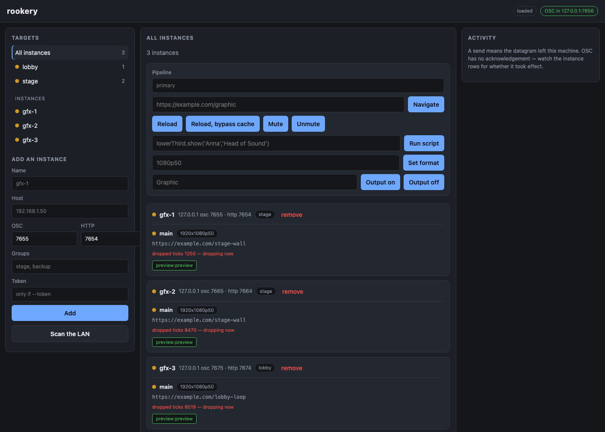

# rookery user guide

rookery is **one web UI for driving as many
[WebLinked](https://github.com/stoatworks-labs/weblinked) instances as you like, all at once**. Tag
them into groups, see every instance's state on one screen, and change what's on air across a whole
group with one action or one OSC cue from a lighting desk.



> **Before you rely on this:** treat it as an early-stage project. It's been run end to end
> against **three real WebLinked instances on one machine**, and
> [verification.md](verification.md) has what that covers. It hasn't been run across a real
> multi-machine rig, and it hasn't been through a show.
>
> This codebase was created with AI assistance, directed and reviewed by a human author.

---

## The one thing that will catch you out

**WebLinked binds its HTTP server to `127.0.0.1` by default.** Start each instance with
`--bind 0.0.0.0` or rookery can't poll it:

```bash
weblinked --url https://example.com --ndi=Graphic --bind 0.0.0.0
```

Without that, **commands go out fine** (WebLinked's OSC listener is on `0.0.0.0` already) **and no
state ever comes back.** The instance shows as unreachable while happily doing everything you tell
it. rookery reports it as it finds it rather than guessing, but it's worth knowing before you go
hunting for a network fault that isn't there.

---

## Getting started

```bash
cp config/example.toml config/rookery.toml
./rookery config/rookery.toml
```

Open <http://127.0.0.1:8090>, add an instance by hostname, and give it a group tag.

**Groups come from tags**, and an instance can be in as many as you like. There's no group object
to maintain, and membership is worked out when a command is sent, so retagging takes effect on the
next cue without anything needing to be rebuilt.

**Discovery** browses for the advertisement WebLinked publishes from 0.8.0 (which carries its
**OSC port and prefix**, the two things its HTTP API can't report), backed up by an active subnet
probe for older instances, instances started with `--no-mdns`, and networks where multicast is
filtered.

---

## A send is not a confirmation

**This is the one to get your head round before you rely on rookery.**

OSC over UDP has no acknowledgement, and WebLinked sends nothing back. So when rookery says a
command was **sent**, it means one thing only: *the datagram left this machine.* It doesn't mean
the instance received it, parsed it or acted on it.

That's why rookery polls every instance's HTTP API. **The dashboard is the confirmation, not the
send.** Nothing in the UI or the API presents a successful send as a confirmed change, and it never
will, because the network can't back that claim up.

Every response is a **per-instance breakdown**, never a single ok:

```json
{
  "target": "group \"stage\"",
  "entries": [
    { "instance_name": "gfx-1", "sent": true,  "error": null },
    { "instance_name": "gfx-2", "sent": false, "error": "cannot resolve gfx-2.local:7655" }
  ]
}
```

---

## Health: what the dots mean

| Dot | Means |
|---|---|
| **green** | Running, no output errors, keeping up with its clock |
| **amber** | Dropping ticks **right now**, or an output that is enabled but not running |
| **red** | An output reported an error — a card in use, a format it cannot do |
| **grey (stopped)** | The source is not running |
| **grey (unknown)** | Not polled, or not yet heard from. Never guessed at |

**"Dropping ticks right now" is a delta, not a total.** WebLinked's dropped-tick count runs up from
the moment it starts, and a healthy instance piles them up: a real one measured here sat at 346 out
of 2205 and climbing, purely because macOS throttles a backgrounded process. Colouring on the total
would paint every instance that's been up for a while permanently amber, and a light that's always
amber tells an operator nothing. rookery compares successive polls instead.

---

## Seeing what is on air

Each instance shows a live picture of its own output. Click one to open it larger.

**Interaction is off until you arm it.** The large view has a *Take control* toggle; until you
press it the picture is view-only and a stray click does nothing. Armed, the pane turns **red** and
mouse and keyboard go straight into the page, which, on a machine that's on air, changes what the
audience sees. **Esc releases it.**

### What the preview costs, and the lever

WebLinked's preview is a **raw BGRA buffer**, 8.3 MB a frame at its default factor. rookery never
sends that to the browser: it fetches it, encodes a JPEG, and hangs an ETag on WebLinked's paint
counter, so a graphic that isn't moving costs a `304` with no body at all.

Measured on three instances at ~4 fps: **0.19 Mbit/s** for animated pages, **zero** for static
ones. Without the JPEG and the ETag the same three would be 95 MB/s.

The remaining lever is the instance's own preview factor, offered per instance in the large view.
It's **opt-in**, because the factor belongs to that instance's preview output, and turning it down
also shrinks the picture on that machine's own control page.

```
factor 1  1920x1080   8.3 MB raw     (the default if you set nothing)
factor 4   480x270    518 KB raw
factor 8   240x135    130 KB raw  ->  about 2 KB as JPEG
```

---

## Driving it from a desk

Turn on the northbound listener in `config/rookery.toml`:

```toml
osc_bind = "0.0.0.0:7656"
```

```
/rookery/all/<verb>
/rookery/group/<tag>/<verb>
/rookery/instance/<name-or-id>/<verb>
/rookery/group/<tag>/source/<source-id>/<verb>
```

**The verbs are WebLinked's own, unchanged:** `url`, `reload`, `script`, `mute`, `format`,
`output/<name>`. So a Companion button or a QLab cue already aimed at one WebLinked becomes a
whole-group button when you edit the front of the address:

```
before:  /weblinked/source/lower-third/output/Graphic
after:   /rookery/group/stage/source/lower-third/output/Graphic
```

Everything the UI does is also available over HTTP; [protocol.md](protocol.md) has the full
grammar.

---

## Security

> **rookery has no authentication, and neither does the thing it drives.**

WebLinked's OSC listener accepts commands from anyone who can reach its UDP port. That's the
protocol, not a choice either project made. WebLinked's `--token` only covers its HTTP API.

A login on rookery alone would look like protection it can't actually give, so there isn't one.
Treat rookery, its northbound OSC port and every instance it manages as one trust boundary, on a
network you control.

---

## If something is wrong

**An instance shows unreachable but is clearly working.** It's bound to loopback. See the top of
this guide.

**A command reported sent and nothing changed.** Sent means the datagram left. Read the dashboard,
not the response.

**Every instance is permanently amber.** It shouldn't be, because the dot is a delta. If it is,
they really are dropping ticks all the time, which is expected on a backgrounded macOS process.

**A preview is eating bandwidth.** Lower that instance's preview factor from the large view, and
remember it shrinks the picture on that machine's own control page too.

**Discovery finds nothing.** Instances older than 0.8.0 don't advertise, `--no-mdns` turns it off,
and multicast is filtered on plenty of venue networks. The active subnet probe covers those;
failing that, add the instance by hostname.
